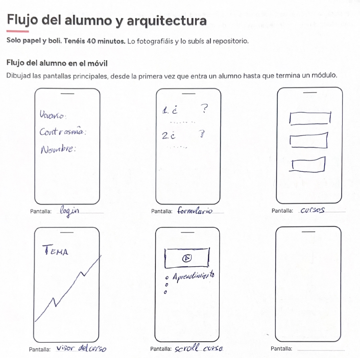
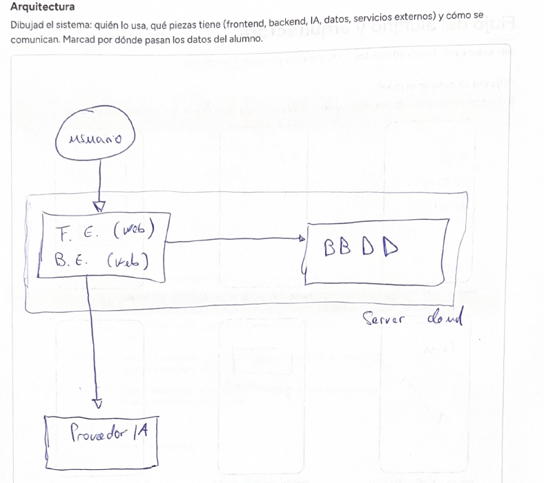

# SPEC — 480 Academy

## 1\. El alumno y su problema

Alumno particular o de empresa que busca desarrollar una habilidad, nuestro objetivo es mejorar su experiencia. Los itinerarios son iguales para todos y solo se completa el 38 % de los vídeos; además, no se mide el aprendizaje real. El acompañamiento es limitado: hay 6 tutores para unos 1.200 alumnos.

## 2\. Flujo del alumno

### Login

Página de registro e inicio de sesión. En el registro el alumno introduce nombre, apellidos, email y contraseña. Estos datos se guardan en nuestra base de datos y nunca se envían a la IA.

### Formulario inicial del alumno

Formulario en el que el alumno indica su nivel, intereses, objetivo, disponibilidad y si hace el curso por su empresa o por su cuenta, para crear su perfil y personalizar su itinerario. No vuelve a pedir datos personales.

### Cursos

Pantalla donde el alumno puede consultar los cursos en los que está inscrito, visualizar su progreso y explorar nuevos cursos disponibles en el catálogo para inscribirse.

### Visor del curso

El progreso del curso se muestra como una montaña: cada módulo es una parada en el camino hacia la cima. Al completar un módulo, el personaje del alumno sube hasta la siguiente parada; al llegar a la cima, se consigue la insignia (*badge*) del curso. Desde aquí se ven también las estadísticas del alumno.

### Scroll

Al entrar a un módulo en un formato “diapositivas” vas *scrolleando* por las diferentes secciones y tests del curso.

## 3\. Respuesta a los problemas

- **Los alumnos saltan los vídeos:** Poner preguntas intravideo (segmentando el vídeo), antes y después, para comprobar el aprendizaje. Además, cada módulo completado hace avanzar al personaje del alumno en la montaña y desbloquea una recompensa, lo que da un motivo para no saltárselo. Por último, presentar el contenido en modo *scrolling* para que sea más sencillo y dinámico el avance.  
- **Los itinerarios son iguales para todos:** Generar un itinerario específico para cada alumno basándonos en sus preferencias obtenidas en el formulario posterior al registro.  
- **No sabemos si el alumno aprende:** Actividades durante el desarrollo de los módulos y recoger estadísticas de los tests y las actividades (entre otras cosas). Análisis de datos mediante IA.  
- **Prometemos un acompañamiento que no damos:** Utilizar la IA para tener un tutor disponible 24/7 que responda dudas, ayude y mentorice al alumno.

## 4\. Historias de usuario

| ID | Como… | Quiero… | Para… | Prioridad | Criterios de aceptación |
| :---- | :---- | :---- | :---- | :---- | :---- |
| **HU1** | Alumno | Responder un formulario inicial corto sobre mi nivel, intereses y objetivo | Que la plataforma conozca mi punto de partida | Imprescindible | Máximo 5 preguntas, usable con una mano en el móvil. No pide datos personales (ya están en el registro). Al enviarlo se guarda mi perfil y paso a mi itinerario. |
| **HU2** | Alumno | Ver un itinerario adaptado a mi perfil, repartido en sesiones por día | No repetir lo que ya domino ni perderme si empiezo de cero | Imprescindible | El itinerario se genera en menos de 10 s tras el formulario. Cada módulo aparece como "recomendado" u "opcional" con una línea que explica por qué. Dos perfiles distintos obtienen itinerarios distintos. |
| **HU3** | Alumno | Ver los vídeos divididos en fragmentos cortos con una pregunta entre cada uno | Comprobar que entiendo lo que veo antes de seguir | Imprescindible | Cada vídeo está dividido en fragmentos según el JSON del Recortador. Al acabar un fragmento aparece una pregunta tipo test. Recibo feedback inmediato (correcto o la explicación del error). Mis respuestas se guardan. |
| **HU4** | Alumno | Ver un resumen del vídeo y hacer directamente el test si ya conozco el contenido | Avanzar sobre los temas que ya domino | Imprescindible | Antes de reproducir el vídeo veo un resumen de sus contenidos y puedo elegir hacer el test. Si lo supero, el vídeo queda como completado; si no, se reproduce y puedo volver a intentarlo. |
| **HU5** | Alumno | Preguntar mis dudas a un profesor particular IA mientras estudio | Resolverlas al momento sin esperar a un tutor | Imprescindible | Responde en español en menos de 10 s, usando el contexto del fragmento que acabo de ver. Límite de 100 consultas al mes por alumno. No está disponible durante los exámenes. |
| **HU6** | Alumno | Ver mi progreso como una montaña con mi personaje y ganar recompensas | Mantener la motivación y saber cuánto me falta para terminar el curso | Imprescindible | El curso se muestra como una montaña donde cada módulo es una parada. Mi personaje avanza al completar cada módulo. Al cerrar un módulo desbloqueo un objeto para mi personaje (botas, camiseta, gorro...) y al llegar a la cima consigo la insignia del curso. Puedo equipar los objetos desbloqueados a mi personaje. |
| **HU7** | Alumno | Acceder a tarjetas de repaso rápidas, incluso sin conexión a Internet | Aprovechar pequeños momentos del día y reforzar mis conocimientos sin necesidad de reproducir vídeos | Deseable | El alumno puede acceder a tarjetas con conceptos y preguntas breves desde el móvil. Las tarjetas descargadas previamente pueden consultarse sin conexión. |
| **HU8** | Tutor | Recibir una ficha resumen semanal de cada alumno con alertas | Dedicar mi tiempo a los alumnos que más lo necesitan | Deseable | La ficha muestra vídeos completados, aciertos y dudas frecuentes. Marca en rojo a los alumnos con bajo rendimiento o inactivos. Los datos que analiza la IA están pseudonimizados: solo llevan un ID aleatorio, sin nombre ni email. |
| **HU9** | Alumno | Responder con mis palabras a mini retos abiertos en los puntos clave del curso y recibir una corrección | Comprobar que sé aplicar lo aprendido, no solo reconocer la respuesta correcta en un test | Deseable | El mini reto aparece al final de las secciones clave. Recibo una nota y un comentario en menos de 10 s. La corrección se basa solo en el contenido de la sección y en mi respuesta. Mi respuesta pasa por el filtro de datos personales antes de llegar a la IA. Máximo 50 mini retos al mes. Mis intentos se guardan. |

5\. Arquitectura

### Resumen

Aplicación web progresiva (PWA) servida desde un servidor cloud con tres contenedores Docker (nginx, backend FastAPI y PostgreSQL), conectada a un único proveedor de IA externo: Mistral AI en la UE.

### Piezas

| Pieza | Tecnología | Qué hace |
| :---- | :---- | :---- |
| Móvil del alumno | Navegador del móvil, PWA instalable | Interfaz mobile-first usable con una mano. Guarda en el móvil las tarjetas del Modo 4G para usarlas sin conexión. |
| Servidor web | nginx (contenedor) | Sirve los ficheros de la PWA y redirige las peticiones `/api` al backend. Gestiona HTTPS. |
| Backend | Python \+ FastAPI (contenedor) | Lógica de la aplicación: login, itinerarios, tests, progreso y puntos. Es la única pieza que habla con la IA: aplica el filtro de datos personales, controla el cupo de cada alumno y guarda la API key. |
| Base de datos | PostgreSQL (contenedor) | Guarda alumnos, perfiles, itinerarios, intentos, consultas y telemetría. Los datos personales nunca salen de aquí. |
| Catálogo | `catalogo.json` | Curso, módulos, vídeos, fragmentos, preguntas, resúmenes y tarjetas. Se carga a mano, sin panel de administración. |
| Proceso offline | Script Python | Se ejecuta una vez por vídeo: Transcriptor (Voxtral) y Recortador (Mistral Small 4). Genera el contenido de `catalogo.json`. |
| Proveedor de IA | Mistral AI (región UE) | Ejecuta los agentes: Selector de cursos, Profesor particular, Examinador y Analizador de datos. |
| Vídeos | Reproductor de vídeo HTML5 en la PWA. Los vídeos se sirven como ficheros desde nuestro servidor (nginx); en producción, desde el almacenamiento de 480 Academy. | Reproduce los vídeos del catálogo dentro de la propia plataforma y los pausa en los puntos que marca el Recortador para mostrar las preguntas. |

### Recorrido de los datos del alumno

1. El alumno usa la PWA en su móvil, que se comunica con el servidor por HTTPS.  
2. nginx pasa la petición al backend FastAPI.  
3. El backend guarda los datos del alumno en PostgreSQL.  
4. Cuando hace falta la IA, el backend quita los datos personales, sustituye la identidad por un ID aleatorio y llama a Mistral.  
5. La respuesta de Mistral vuelve al backend, que la guarda y la envía al móvil.

El móvil nunca llama directamente a la IA, y Mistral nunca recibe nombres, emails ni datos identificables.

### Pensado para integrarse después

El backend expone una API REST documentada automáticamente por FastAPI (OpenAPI). Cuando la plataforma de 480 Academy tenga API, el login, el catálogo y el progreso se pueden conectar a ella sin cambiar la PWA ni los agentes.

## 6\. Modelo de datos y flujo de IA

### Entidades principales (PostgreSQL, en nuestro servidor)

| Entidad | Datos que guarda | ¿Sale hacia la IA? |
| :---- | :---- | :---- |
| Alumno | ID aleatorio (UUID), nombre, apellidos, email, contraseña cifrada, menor de edad (sí/no) | No, nunca |
| Perfil | Nivel, intereses, objetivo, disponibilidad y si hace el curso por su empresa (sí/no). Respuestas del formulario inicial | Sí, sin ID ni alias |
| Catálogo | Curso, módulos, vídeos, fragmentos y transcripciones (`catalogo.json`) | Sí, no es dato personal |
| Itinerario | Lista ordenada de módulos y fragmentos recomendados para cada alumno | No, lo genera la IA y se guarda en local |
| Intento | Respuestas a preguntas, tests y mini retos, con nota y fecha | Sí, solo el texto de la respuesta, filtrado |
| Consulta | Dudas enviadas al Profesor particular y sus respuestas | Sí, solo el texto de la duda, filtrado |
| Telemetría | Eventos de vídeo: play, pausa, salto, fragmento completado | Sí, agregada y con el ID aleatorio |
| Ficha tutor | Resumen semanal y alertas por alumno | No, se asocia al alumno solo en nuestro servidor |
| Recompensas y personaje | Insignias conseguidas, objetos desbloqueados y objetos equipados en el personaje | No, nunca |
| Inscripción | Alumno, curso inscrito, fecha de inscripción y estado de la inscripción | No, se gestiona en nuestro servidor |
| Progreso | Fragmentos y módulos completados, porcentaje de avance, puntos y checkpoints alcanzados | Sí, solo datos de aprendizaje necesarios para el análisis, sin datos identificativos directos |

Qué datos salen hacia cada agente

| Agente | Qué recibe | Datos personales |
| :---- | :---- | :---- |
| Transcriptor y Recortador | Audio y transcripción de los vídeos del catálogo | Ninguno |
| Selector de cursos | Nivel, intereses, objetivo y mapa del curso | Ninguno (sin ID ni alias) |
| Profesor particular | Texto de la duda, fragmento actual y nivel | Ninguno tras el filtro |
| Examinador | Respuesta al reto y contenido del fragmento | Ninguno tras el filtro |
| Analizador de datos | Telemetría y notas con ID aleatorio | Pseudonimizados |

### Cómo cumplimos la condición de privacidad

- **Minimización:** los datos de registro (nombre, apellidos, email) solo se usan para identificar al alumno en la plataforma y se quedan en nuestra base de datos. El formulario inicial no vuelve a pedirlos: solo pregunta lo necesario para personalizar (nivel, intereses y objetivo).

- **Pseudonimización:** la IA solo ve un ID aleatorio. La relación entre ese ID y el alumno real solo existe en nuestra base de datos.

- **Filtro de datos personales:** antes de enviar cualquier texto escrito por el alumno (dudas, retos), el backend lo pasa por un filtro en dos pasos, que se ejecuta en nuestro servidor:

  1. Expresiones regulares para emails, teléfonos y DNI/NIE.  
  2. Un pequeño modelo de IA, Redact, filtra los datos sensibles.

  Lo detectado se sustituye por `[DATO]` antes de llamar a Mistral. Ningún filtro automático es perfecto, por eso se combina con las demás medidas: la IA nunca recibe el nombre ni el email del alumno y solo ve un ID aleatorio.

- **Proveedor europeo:** Mistral AI con servidores en la UE y sin uso de los datos para entrenar modelos.

- **La clave de la API solo está en el backend:** el móvil nunca llama directamente a la IA.

- **Menores:** si el alumno tiene menos de 14 años, se requiere el consentimiento del padre, madre o tutor legal al registrarse (LOPDGDD, art. 7).

- **Conservación limitada:** las consultas y respuestas libres se borran a los 90 días, y el alumno puede pedir la eliminación de todos sus datos.

## 7\. Agentes de IA

| Agente | Qué hace | Modelo y por qué | Entrada | Salida | Límites |
| :---- | :---- | :---- | :---- | :---- | :---- |
| Transcriptor (Offline) | Transcribe los vídeos a texto para nuestra BBDD | Voxtral, transcriptor de audio de Mistral | Archivo de audio o enlace del vídeo del catálogo | Transcripción en texto plano con marcas de tiempo | 1 ejecución por vídeo |
| Recortador de vídeo (Offline) | Divide los vídeos en fragmentos, marca dónde van las preguntas y genera las preguntas tipo test, el resumen de cada vídeo y las tarjetas del Modo 4G | Mistral Small 4 | Transcripción completa con timestamps del Transcriptor | JSON con fragmentos, preguntas, resumen y tarjetas (se guarda en `catalogo.json`) | 1 ejecución por vídeo |
| Selector de cursos personalizado | Selecciona los módulos y subsecciones más relevantes según las respuestas del alumno y sus aptitudes | Ministral 3 8B | Respuestas del formulario inicial, nivel/aptitudes y mapa de subsecciones del curso | JSON con itinerario personalizado | 1 petición al empezar el curso; no genera contenido, solo filtra |
| Profesor particular | Resuelve dudas rápidas del alumno en español con el contexto de la subsección que acaba de ver | Mistral Small 4 | Duda del alumno, curso activo, subsección, nivel del alumno | Explicación breve | Máximo 100 consultas al mes por alumno. Solo resuelve dudas sobre los vídeos, no durante los exámenes. |
| Examinador | Plantea mini retos abiertos en secciones clave y corrige la respuesta del alumno | Mistral Small 4 | Subsección actual \+ enunciado del mini reto \+ respuesta del alumno | Nota y feedback | Máximo 50 mini retos al mes por alumno. Evalúa solo en base al contenido de la sección y la respuesta. |
| Analizador de datos | Analiza la telemetría del usuario (vídeos vistos, pausas, aciertos) y sus preguntas para ofrecer un resumen personalizado al tutor | Mistral Small 4 | Telemetría, notas y dudas filtradas, con ID aleatorio (pseudonimizadas) | Ficha resumen para los tutores y estadística avanzada | Analiza a posteriori el lote |

## 8\. Contenido

### Curso elegido

**Introducción a Python.** Es un curso de formación tecnológica como los del catálogo de 480 Academy y reproduce su problema real: alumnos con niveles muy distintos (desde quien nunca ha programado hasta quien ya conoce otro lenguaje), lo que permite demostrar la personalización del itinerario.

### Vídeos (12 vídeos de YouTube en español, 13-25 minutos)

Curso de origen: *"Curso Python desde 0"*, canal Píldoras Informáticas.

Para el prototipo, los vídeos se descargan y se sirven desde nuestro servidor, igual que funcionaría con el catálogo propio de 480 Academy. Los enlaces de la tabla indican el origen de cada vídeo.

| Módulo | Nº | Vídeo | Enlace | Duración | Transcripción |
| :---- | :---- | :---- | :---- | :---- | :---- |
| 1\. Primeros pasos | 1 | Introducción (Vídeo 2\) | [https\://www\.youtube.com/watch?v=9ojhJsXNWCI](https://www.youtube.com/watch?v=9ojhJsXNWCI) | 15:03 | Subtítulos de YouTube |
| 1\. Primeros pasos | 2 | Sintaxis básica I (Vídeo 3\) | [https\://www\.youtube.com/watch?v=yppT6GPZMyo](https://www.youtube.com/watch?v=yppT6GPZMyo) | 13:23 | Generada con Voxtral |
| 1\. Primeros pasos | 3 | Tipos, operadores y variables (Vídeo 4\) | [https\://www\.youtube.com/watch?v=u4I9PqhqCo8](https://www.youtube.com/watch?v=u4I9PqhqCo8) | 21:27 | Generada con Voxtral |
| 2\. Control de flujo | 4 | Condicionales I (Vídeo 10\) | [https\://www\.youtube.com/watch?v=iV-4F0jGWak](https://www.youtube.com/watch?v=iV-4F0jGWak) | 22:57 | Subtítulos de YouTube |
| 2\. Control de flujo | 5 | Condicionales II (Vídeo 11\) | [https\://www\.youtube.com/watch?v=cf7o4s9nFu8](https://www.youtube.com/watch?v=cf7o4s9nFu8) | 20:47 | Generada con Voxtral |
| 2\. Control de flujo | 6 | Bucles I: For (Vídeo 14\) | [https\://www\.youtube.com/watch?v=GQGhU1526Oo](https://www.youtube.com/watch?v=GQGhU1526Oo) | 18:18 | Generada con Voxtral |
| 3\. Estructuras de datos | 7 | Las listas (Vídeo 7\) | [https\://www\.youtube.com/watch?v=Q8hugySbLQQ](https://www.youtube.com/watch?v=Q8hugySbLQQ) | 24:35 | Subtítulos de YouTube |
| 3\. Estructuras de datos | 8 | Las tuplas (Vídeo 8\) | [https\://www\.youtube.com/watch?v=Ufqh8aoR9hE](https://www.youtube.com/watch?v=Ufqh8aoR9hE) | 18:41 | Generada con Voxtral |
| 3\. Estructuras de datos | 9 | Los diccionarios (Vídeo 9\) | [https\://www\.youtube.com/watch?v=2OmgHl8lp0I](https://www.youtube.com/watch?v=2OmgHl8lp0I) | 21:11 | Generada con Voxtral |
| 4\. Funciones y ficheros | 10 | Funciones I (Vídeo 5\) | [https\://www\.youtube.com/watch?v=VY448UWAQ\_0](https://www.youtube.com/watch?v=VY448UWAQ_0) | 18:26 | Subtítulos de YouTube |
| 4\. Funciones y ficheros | 11 | Funciones II (Vídeo 6\) | [https\://www\.youtube.com/watch?v=vawEHhV\_HFA](https://www.youtube.com/watch?v=vawEHhV_HFA) | 16:34 | Generada con Voxtral |
| 4\. Funciones y ficheros | 12 | Archivos externos I (Vídeo 37\) | [https\://www\.youtube.com/watch?v=V87m9SltcI8](https://www.youtube.com/watch?v=V87m9SltcI8) | 15:36 | Generada con Voxtral |

### De dónde salen el texto y las transcripciones

Reproducimos la situación real de 480 Academy: solo un 30 % del catálogo tiene transcripción. En nuestra muestra, 4 de los 12 vídeos (33 %) usan los subtítulos existentes de YouTube, revisados a mano.

Los 8 vídeos restantes se transcriben con el agente Transcriptor (Voxtral de Mistral), que genera texto con marcas de tiempo. Es un proceso offline que se ejecuta una sola vez por vídeo.

Todas las transcripciones pasan por el agente Recortador, que divide cada vídeo en fragmentos y marca dónde van las preguntas. El resultado se guarda en `catalogo.json`.

Las preguntas tipo test, los resúmenes de cada vídeo y los mini retos se generan a partir de esas transcripciones y los revisa el equipo antes de publicarlos, para evitar errores de la IA.

El catálogo se carga a mano mediante `catalogo.json`, sin panel de administración, tal como pide el cliente.

## 9\. Coste

Todos los precios están en dólares, que es la moneda de la tarifa de Mistral, y son los de pago por uso consultados en noviembre de 2026\.

### Coste único (procesar el catálogo)

| Tarea | Hipótesis | Coste |
| :---- | :---- | :---- |
| Transcriptor (Voxtral Mini Transcribe, 0,003 \$/min) | 280 vídeos sin transcripción (70 % de 400\) × 15 min \= 4.200 min | 12,60 \$ |
| Recortador (Mistral Small 4\) | 400 vídeos × (5.000 tokens de entrada \+ 3.000 de salida) | 1,02 \$ |
| **Total** |  | **≈ 14 \$, una sola vez** |

### Coste mensual por alumno (peor caso: todos agotan su cupo)

| Agente | Modelo | Uso al mes | Tokens por llamada (entrada / salida) | Por alumno | 1.200 alumnos |
| :---- | :---- | :---- | :---- | :---- | :---- |
| Selector de cursos | Ministral 3 8B | 1 al empezar cada curso (suponemos 1 curso nuevo al mes) | 2.000 / 500 | 0,0004 \$ | 0,48 \$ |
| Profesor particular | Mistral Small 4 | 100 dudas | 1.500 / 600 | 0,0585 \$ | 70,20 \$ |
| Examinador | Mistral Small 4 | 50 mini retos | 2.000 / 300 | 0,0240 \$ | 28,80 \$ |
| Analizador de datos | Mistral Small 4 | 4 informes (1 por semana) | 3.000 / 400 | 0,0028 \$ | 3,36 \$ |
| **Total** |  |  |  | **0,086 \$** | **≈ 103 \$/mes** |

### Cómo lo reduciríamos

- **Lotes para el Analizador y el Recortador:** No necesitan respuesta inmediata, así que pueden ir por la API batch de Mistral, que cuesta la mitad.  
- **Procesamiento previo del contenido:** Los agentes Transcriptor y Recortador procesan los vídeos una sola vez. Los resultados se reutilizan sin generar nuevas peticiones por cada alumno.  
- **Caché de prompts en el Profesor y el Examinador:** Las instrucciones y el contenido del fragmento se repiten en cada llamada, y Mistral cobra mucho menos los tokens de entrada repetidos.  
- **Respuestas cortas:** En el Profesor, la salida supone el 60 % del coste. Limitar la longitud de las respuestas es el ahorro más directo.  
- **Reutilizar itinerarios:** El formulario tiene 5 preguntas cerradas, así que hay pocas combinaciones posibles. Los itinerarios se pueden guardar y reutilizar para perfiles iguales.  
- **Cupos por alumno:** Los límites de 100 dudas y 50 mini retos ya fijan un techo de gasto conocido.

## 10\. Ideas originales

Transformar la plataforma actual en un entorno personalizado y medible con mentalidad *mobile-first*, dando tiempo a los tutores para realizar mentorías personalizadas y con mayor valor a los alumnos. Nuestra plataforma ofrece un entorno visual con recompensas y checkpoints en el que los alumnos ven su progreso y están motivados a mejorar. Integramos 6 agentes de IA que cubren el ciclo y sirven de apoyo al alumno en su ciclo completo:

- Personalización desde el principio.  
- Acompañamiento real y validación instantánea, ofreciendo retos abiertos y soluciones.  
- Visibilidad real y análisis de datos, liberando a los tutores y entregando soluciones.

### Idea 1: Modo 4G (repaso en 5 minutos)

- **Qué es:** un modo de estudio para los ratos muertos (el autobús, una pausa en el trabajo, una cola), cuando el alumno no puede ver un vídeo de 20 minutos con sonido o no tiene buena cobertura. En lugar del vídeo, la app muestra tarjetas de repaso que se pasan con una mano, cada una con un concepto clave del fragmento y una pregunta rápida.  
- **Cómo funciona:**  
  - Las tarjetas las genera el Recortador una sola vez por fragmento, a partir de las transcripciones. No hay llamadas a la IA por alumno, así que el coste mensual no aumenta.  
  - La PWA descarga en segundo plano las tarjetas de los próximos módulos del itinerario del alumno, para que funcionen aunque se pierda la cobertura.  
  - En producción, las tarjetas que el alumno falla volverían a aparecer en días posteriores (repaso espaciado), y las respuestas se sincronizarían con el servidor al recuperar la conexión. En el prototipo solo implementamos la consulta sin conexión.  
- **Por qué mejora la experiencia del alumno:**  
  - El 71 % del tráfico de 480 Academy llega desde el móvil, pero los vídeos largos están pensados para verse con tiempo. El Modo 4G usa el móvil para lo que se usa de verdad: sesiones cortas.  
  - Si el alumno no puede ver el vídeo en ese momento, al menos repasa lo esencial en lugar de saltárselo.  
  - El repaso espaciado mejora la memoria a largo plazo y prepara mejor el examen final.  
- **Por qué mejora el trabajo de los tutores:**  
  - Los resultados de las tarjetas llegan al Analizador de datos, así los tutores saben qué conceptos fallan más alumnos y pueden centrar ahí sus mentorías.

### Idea 2: La montaña y el personaje

- **Qué es:** cada curso es una montaña y cada módulo es una parada del camino. El alumno tiene un personaje propio que sube la montaña a medida que avanza. Al completar módulos desbloquea objetos para personalizarlo (botas, camisetas, gorros) y al llegar a la cima gana la insignia del curso.

  Además, al llegar a la cima el alumno obtiene un certificado visual con su personaje equipado, que puede descargar o compartir en LinkedIn. Hoy 480 Academy no ofrece certificado: para el alumno es un logro que puede enseñar, y para la academia, publicidad gratuita en cada publicación. El certificado se genera en el móvil del alumno, sin IA; el nombre es opcional y los menores de edad no ven la opción de LinkedIn.

- **Por qué mejora la experiencia del alumno:**

  - El progreso deja de ser un porcentaje abstracto: el alumno ve dónde está y cuánto le falta.  
  - Cada módulo da una recompensa visible, y eso da un motivo para no saltarse módulos ni vídeos.  
  - El personaje es suyo y lo personaliza con lo que ha ganado aprendiendo, no comprando, lo que refuerza su vínculo con la plataforma.  
- **Por qué mejora el trabajo de los tutores:**

  - La posición de cada alumno en la montaña permite ver de un vistazo quién avanza y quién se ha quedado parado.

### Hacia dónde podría crecer: el contenido que aprende de sus alumnos

Las dudas al Profesor IA, los fallos en las preguntas y los rebobinados ya se guardan asociados a cada fragmento. Agrupándolos, el Analizador de datos podría avisar cada semana de qué partes de los vídeos no se entienden bien. Así 480 Academy sabría qué contenido mejorar con datos reales y no con intuiciones, sin coste añadido y sin datos personales, porque el análisis es por fragmento y no por alumno.

## 11\. Alcance

### Qué entra

- **HU1.** Registro y formulario inicial con nivel, intereses y objetivo.  
- **HU2.** Itinerario personalizado generado por el Selector de cursos.  
- **HU3.** Vídeos divididos en fragmentos con preguntas tipo test entre ellos.  
- **HU4.** Ver el resumen del vídeo y hacer el test directamente para saltarlo.  
- **HU5.** Profesor particular IA para resolver dudas sobre el fragmento actual.  
- **HU6.** Progreso en forma de montaña con el personaje del alumno, insignia al llegar a la cima y objetos desbloqueables por módulo (versión básica: un personaje con 3-4 objetos).  
- Catálogo de 12 vídeos de un único curso (Introducción a Python), procesado previamente con el Transcriptor y el Recortador y cargado en `catalogo.json`.  
- Filtro básico de datos personales antes de enviar texto a la IA.  
- Despliegue con Docker Compose (nginx, FastAPI y PostgreSQL) accesible desde el móvil para la demo.

### Qué entra si da tiempo

- **HU7.** Modo 4G en versión básica: tarjetas de repaso generadas a partir de las transcripciones y guardadas en el móvil con la PWA.  
- **HU8.** Ficha resumen para tutores generada por el Analizador de datos.  
- **HU9.** Mini retos abiertos corregidos por la IA (agente Examinador).  
- Certificado del curso con el personaje en la cima, descargable y compartible en LinkedIn (especificado en `CERTIFICADO.md`).

### Qué queda fuera

- Registro completo: recuperación de contraseña y consentimiento parental real para menores.  
- Repaso espaciado y sincronización sin conexión del Modo 4G.  
- Tienda o catálogo amplio de objetos para el personaje y animaciones elaboradas.  
- Integración con la plataforma actual de 480 Academy, que no tiene API pública.  
- Panel de administración y subida de vídeos, que el cliente no quiere.  
- Despliegue en producción, alta disponibilidad y escalado para 1.200 alumnos.  
- Informe semanal de fragmentos problemáticos para el equipo de contenidos (se describe en el apartado 10 como línea futura).

### Por qué

Tenemos una sesión de 4 horas más la semana opcional. Priorizamos una demo de punta a punta desde el móvil que muestre el recorrido completo del alumno: registro, itinerario personalizado, vídeo con preguntas, dudas con el profesor IA y su personaje subiendo la montaña. Esto cubre los cuatro problemas del cliente y nuestra idea original. Lo que queda fuera no aporta a esa demo o depende de sistemas del cliente a los que no tenemos acceso, pero la arquitectura está pensada para añadirlo después.